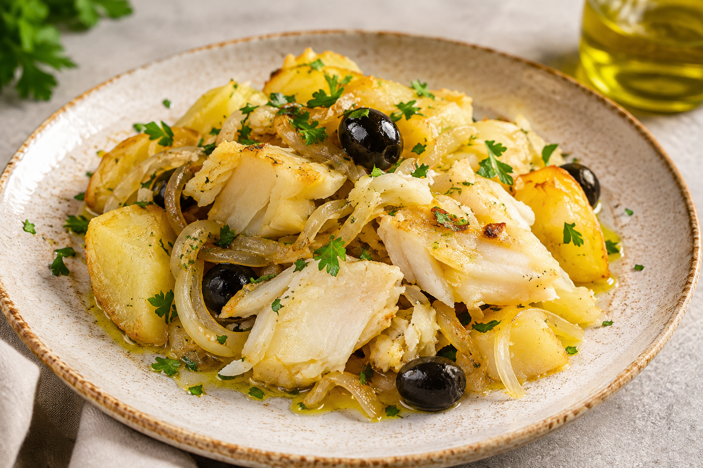
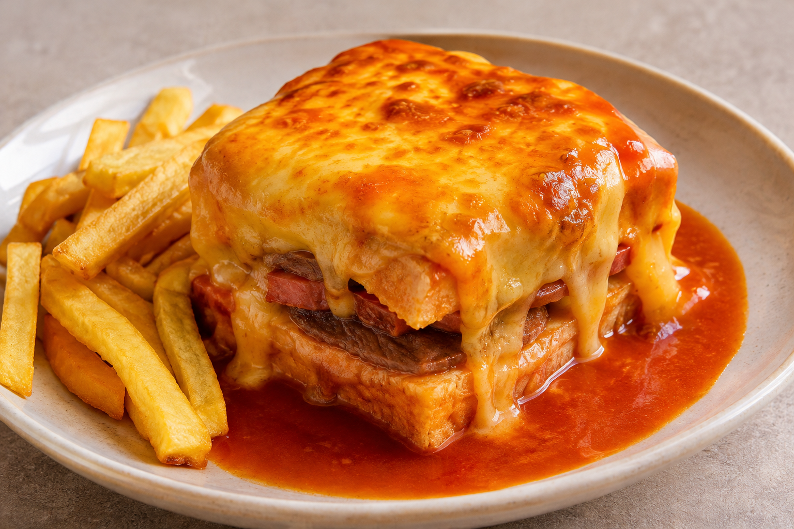
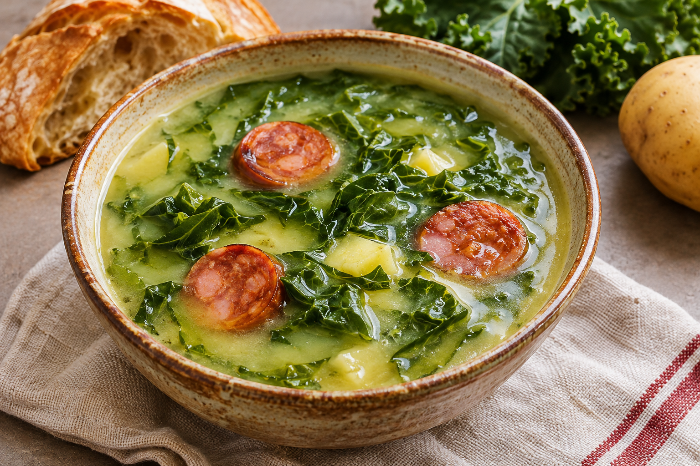
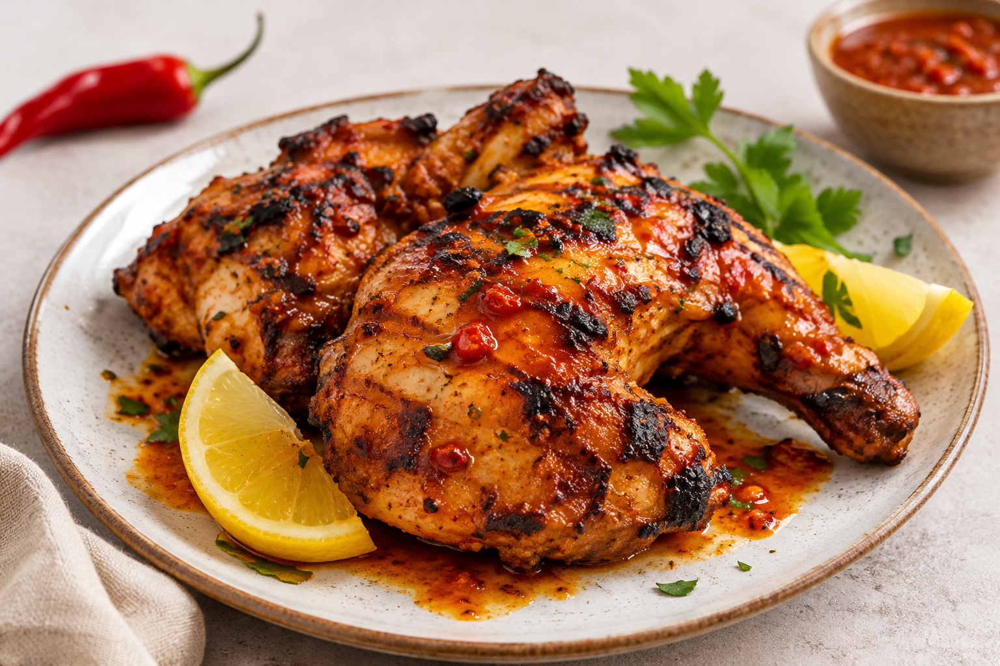

# Portugiesisches Essen

Portugal ist nicht nur für seine schönen Strände und historischen Städte bekannt, sondern auch für seine leckere Küche.

Die portugiesische Küche ist besonders für frischen Fisch, Meeresfrüchte, herzhafte Gerichte und süße Spezialitäten bekannt.

## Pastéis de Nata

Pastéis de Nata sind kleine Blätterteigtörtchen mit einer cremigen Eierfüllung.

Sie gehören zu den bekanntesten Süßspeisen Portugals und werden häufig mit Zimt bestreut.

## Bacalhau

Bacalhau ist gesalzener und getrockneter Kabeljau.

Er wird in Portugal auf viele verschiedene Arten zubereitet, zum Beispiel mit Kartoffeln, Zwiebeln und Olivenöl.

## Francesinha

Francesinha ist ein bekanntes Gericht aus Porto.

Es besteht aus einem Sandwich mit Fleisch, geschmolzenem Käse und einer würzigen Soße. Häufig wird es mit Pommes frites serviert.

## Caldo Verde

Caldo Verde ist eine traditionelle portugiesische Suppe.

Sie wird aus Kartoffeln, Zwiebeln, Olivenöl und fein geschnittenem grünem Blattgemüse zubereitet. Oft enthält sie auch Chouriço, eine würzige Wurst.

## Frango Piri-Piri

Frango Piri-Piri ist gegrilltes Hähnchen mit einer scharfen Piri-Piri-Soße.

Das Gericht ist besonders bei Menschen beliebt, die gerne würzig essen.

## Mein Fazit

Die portugiesische Küche ist abwechslungsreich und bietet sowohl herzhafte Gerichte als auch leckere Süßspeisen.

Wer Portugal besucht, sollte unbedingt Pastéis de Nata probieren!