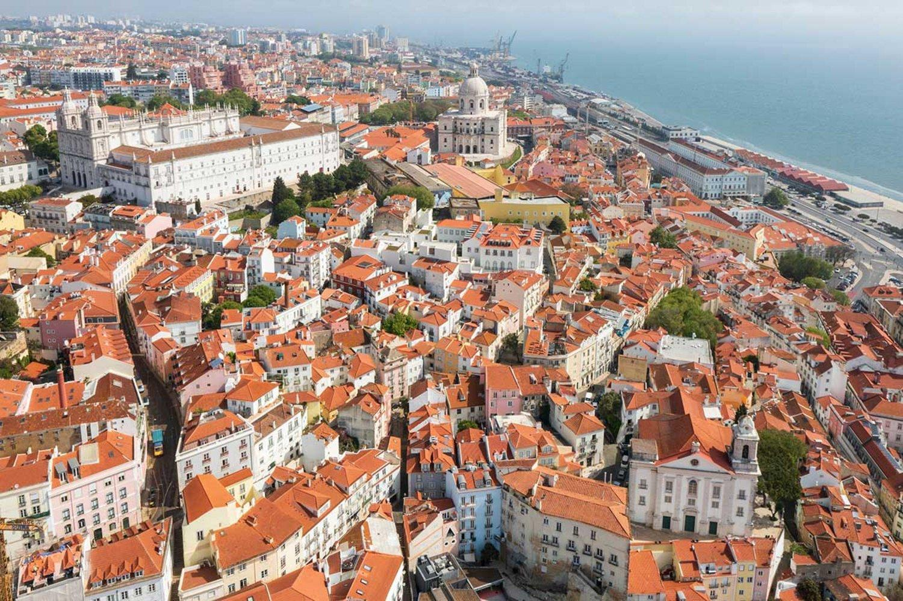
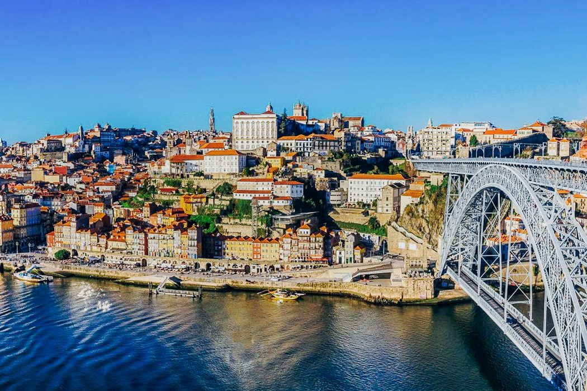

# Die Geschichte Portugals
## 1. Die Entstehung Portugals
Portugal liegt im Südwesten Europas auf der Iberischen Halbinsel. Im Jahr 1143 wurde Portugal als eigenständiges Königreich anerkannt. Der erste König hieß Afonso I. Im Jahr 1179 bestätigte auch der Papst die Unabhängigkeit.

*Lissabon, Portugal*
[Quelle: Lisboa.pt](https://www.lisboa.pt/entrada?utm_source=chatgpt.com)

## 2. Die Zeit der Entdeckungen
Im 15. und 16. Jahrhundert wurde Portugal zu einer wichtigen Seemacht. Portugiesische Seefahrer entdeckten neue Seewege nach Afrika, Asien und Südamerika.

Im Jahr 1498 erreichte Vasco da Gama Indien auf dem Seeweg. Im Jahr 1500 erreichte Pedro Álvares Cabral Brasilien. Portugal baute ein großes Kolonialreich auf.
## 3. Portugal wird eine Republik
Im Jahr 1910 wurde die Monarchie abgeschafft und Portugal wurde eine Republik. Später herrschte viele Jahre eine Diktatur.

Am 25. April 1974 beendete die Nelkenrevolution die Diktatur und machte den Weg für die Demokratie frei.
## 4. Portugal heute
Seit 1986 ist Portugal Mitglied der Europäischen Union. Die Hauptstadt ist Lissabon. Portugal ist heute bekannt für seine Geschichte, seine schönen Strände, seine Kultur und seine Seefahrer.

*Lissabon heute, Portugal*
[Quelle: 22plaaces.de](https://www.22places.de/porto-stadtfuehrungen/?utm_source=chatgpt.com)
